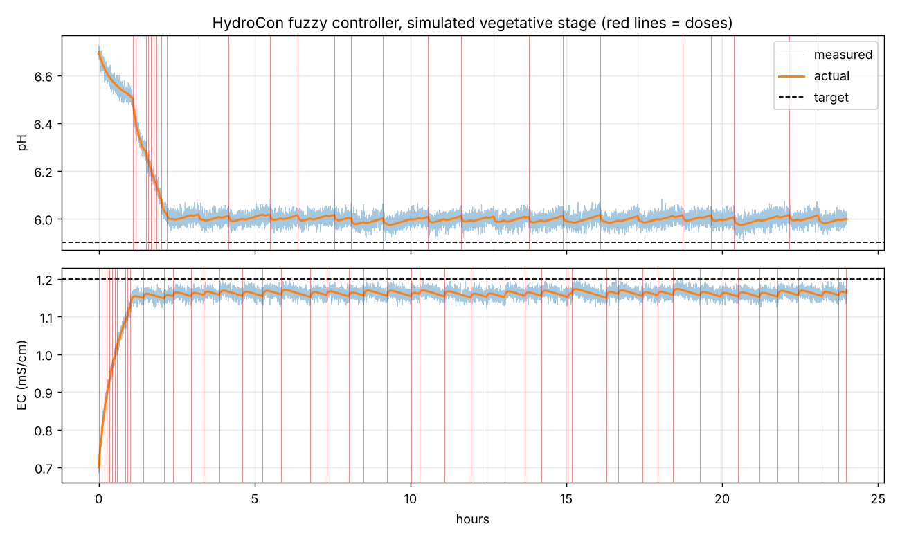

# HydroCon Raspberry Pi controller

Fuzzy logic EC and pH dosing for the NFT reservoir. It runs on the Raspberry Pi next to the Mosquitto broker, reads the sensor node over MQTT, decides whether to dose, and switches the dose node's pumps.

## How it decides

Every 30 seconds (`control.interval_seconds`):

1. **Data checks:** skip if the sensor node has gone quiet (>60 s) or a reading is physically implausible (probe or calibration fault).
2. **Mixing lockout:** after any dose, wait `mixing_seconds` (5 min) so the solution mixes before measuring again.
3. **Smoothing:** median of the last 5 readings rejects single glitches; a linear regression over the last 10 minutes gives the **trend**.
4. **EC first:** the EC fuzzy controller decides how long to run nutrient pumps A and B (equal time, with a gap so concentrated A and B never meet).
5. **Then pH:** only if no nutrients were dosed this cycle, because nutrients shift pH.
6. **Daily limits** per pump stop a runaway (e.g. a broken probe reading low forever).

Setpoints come from the **growth stage**. One camera frame per hour is classified with the ResNet-18 model from `ml/`, and the stage only changes when the majority of the last 5 predictions agree.

### Fuzzy controllers (Mamdani, min–max, centroid)

Both controllers have two inputs: **error** from setpoint and **trend** (change per 10 min). The trend input is what stops the controller from dosing again while the value is already moving toward the target.

**EC**: error = target − EC (mS/cm); output = fraction of max nutrient dose (0–1)

| error ↓ / trend → | falling | steady | rising |
|---|---|---|---|
| too_high | none | none | none |
| ok | none | none | none |
| small | short | short | none |
| medium | medium | medium | short |
| large | long | long | medium |

EC above target can't be fixed by dosing, so the controller logs a "top up with fresh water" warning instead.

**pH**: error = pH − target; output −1…1 (negative = pH UP, positive = pH DOWN)

| error ↓ / trend → | falling | steady | rising |
|---|---|---|---|
| very_low | up_large | up_large | up_small |
| low | up_small | up_small | none |
| ok | none | none | none |
| high | none | down_small | down_small |
| very_high | down_small | down_large | down_large |

Membership functions are in `hydrocon/controllers.py`; the inference engine (`hydrocon/fuzzy.py`) is plain Python so the Pi needs no extra libraries.

## Setup on the Pi

```bash
sudo apt install mosquitto mosquitto-clients python3-venv
cd ~/HydroCon/controller
python3 -m venv .venv
.venv/bin/pip install -r requirements.txt
# optional, for growth stage classification:
.venv/bin/pip install torch torchvision pillow
```

Copy the trained model into `controller/models/` (`growth_stage_full_model.pt` and `class_names.json` from `ml/train_growth_stage_model.py`). Without it, the controller uses `growth.initial_stage`.

**Before the first real run**, edit `config.yaml`:
- `setpoints`: the EC/pH targets you want per stage
- `dosing.max_seconds`: pump time at full output. Measure your pumps' flow (ml/s) and your reservoir volume, and start small
- `dosing.daily_limit_seconds`: hard caps per pump

Then run it in **dry-run mode** first. It decides and logs but never switches a pump:

```bash
.venv/bin/python -m hydrocon.main --config config.yaml --dry-run
```

Every decision goes to `data/controller_log.csv` (readings, trends, fuzzy outputs, action) and to the retained MQTT topic `nft/controller/status`:

```bash
mosquitto_sub -t nft/controller/status -v
```

When the decisions look right, run without `--dry-run`, or install it as a service so it starts on boot:

```bash
sudo cp hydrocon-controller.service /etc/systemd/system/
sudo systemctl enable --now hydrocon-controller
journalctl -u hydrocon-controller -f
```

## Simulation

`simulate.py` runs the real decision logic against a simple reservoir model (plant uptake lowers EC and raises pH, doses mix in with a lag, sensors are noisy). Use it to tune the config without hardware, and for report figures:

```bash
python simulate.py --hours 24 --stage vegetative --ph0 6.7 --ec0 0.7 --plot sim.png
```



Starting from pH 6.7 / EC 0.7, the controller reaches target in 1–2 hours and then holds with small top-up doses, without overshoot. The model constants at the top of the file are guesses; replace them with values measured on your tank.

## Tests

```bash
python -m unittest discover -s tests -v
```

## Known limitations

- **Pump stays on if the Pi dies mid-dose.** The controller always sends OFF (also on Ctrl+C / `systemctl stop`), but a power cut during a dose leaves the relay ON. The robust fix is in the dose node firmware: accept a duration and switch the relay off by itself.
- **Growth node MQTT images.** PubSubClient's default 256-byte buffer and the 1 KB JSON document are too small for a camera photo, so `nft/growth_node/image` likely never arrives. The controller grabs frames from the node's `/stream` URL instead. Set `growth.stream_url` in the config if the Pi starts after the growth node (the URL is only published at boot).
- **Deadband offset.** Values settle near the edge of the "ok" band (about ±0.1 pH, ±0.05 mS/cm) because the controller deliberately ignores tiny errors. Narrow the `ok` membership functions if you need tighter control.
